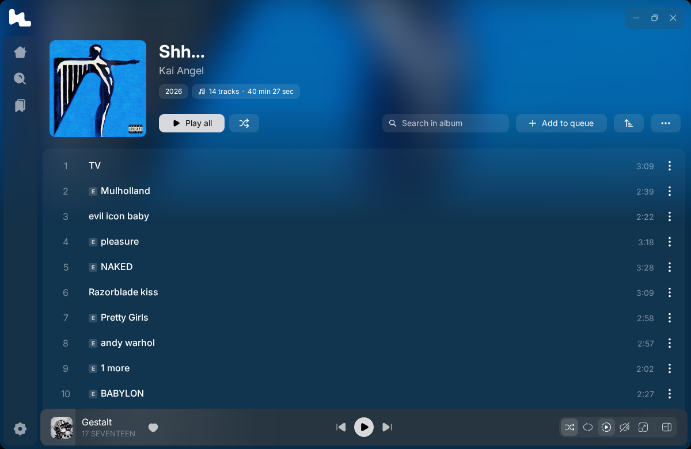
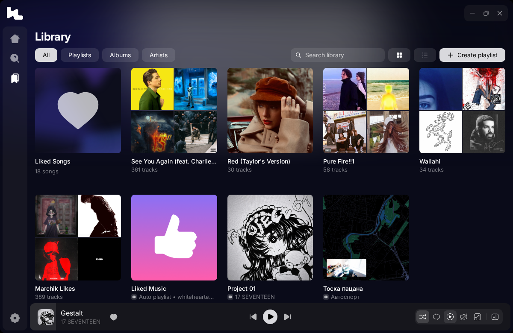

<div align="center">

# Liner

**Modern desktop music streaming player with syllable-synced lyrics and reactive dynamic visuals.**

[](https://github.com/tryliner/desktop/actions/workflows/ci.yml) [](https://github.com/tryliner/desktop/releases/latest) [](https://github.com/tryliner/desktop/releases) [](https://github.com/tryliner/desktop/releases/latest) [](https://github.com/tryliner/desktop/discussions) [](./LICENSE)

[Preview](#preview) • [Architecture](#architecture) • [Getting Started](#getting-started) • [Building](#building) • [Docs](#docs) • [Contributing](#contributing) • [License](#license)

<br/>



</div>

---

## Preview

<div align="center">
  <table>
    <tr>
      <td align="center" width="50%">
        
        <br/>
        <sub><b>Library</b></sub>
      </td>
      <td align="center" width="50%">
        
        <br/>
        <sub><b>Fullscreen lyrics</b></sub>
      </td>
    </tr>
  </table>
</div>

---

> [!NOTE]
> Liner client connects to the official Liner API backend for music catalog, streaming playback, and synchronized lyrics.

---

## Architecture

The renderer follows [Feature-Sliced Design](https://feature-sliced.design): imports only point down the layers (`app` → `widgets` → `features` → `entities` → `shared`).

```
liner/desktop/
├── electron/
│   ├── main.ts              # Main process: windows, IPC, updates, deep links
│   ├── preload.ts           # Context bridge between the renderer and the main process
│   ├── local-tracks/        # Imported audio files and the liner-local:// protocol
│   ├── youtube/             # Helpers for the YouTube playback fallback
│   ├── overlay.ts           # Floating overlay player window
│   ├── discord.ts           # Discord Rich Presence
│   ├── crypto.ts            # In-memory WebAssembly request signer
│   └── signer.ts            # Embedded WebAssembly binary
├── native/                  # Windows snap preview add-on
├── src/
│   ├── app/                 # App shell, routes, providers, global styles
│   ├── widgets/             # Screen blocks: sidebar, header, player bar, fullscreen player, modals
│   ├── features/            # player, lyrics, library, search, collection, settings, overlay, …
│   ├── entities/            # track, playlist, artist, user
│   ├── shared/              # API client, storage, UI kit, contracts, utilities
│   ├── languages/           # Translations for 11 languages
│   └── main.tsx             # Vite entry point
├── docs/                    # Design, storage, privacy, translations, FAQ
├── package.json
└── vite.config.ts
```

---

## Getting Started

### Prerequisites

- **Node.js** `v22+` and **pnpm** `v10+`
- Windows 10/11, macOS or Linux

---

### Setup

```bash
git clone https://github.com/tryliner/desktop.git
cd desktop
pnpm install
```

---

### Running in Development

```bash
# Electron app with Vite hot reload
pnpm dev
```

---

## Testing

```bash
# Tests only
pnpm test

# Everything CI runs on a pull request: lint, format check, types, build, tests
pnpm check
```

---

## Building

```bash
# Linux (AppImage & .deb)
pnpm electron:build:linux

# Windows (.exe installer)
pnpm electron:build:win

# macOS (.dmg & .zip, for both Intel and Apple Silicon)
pnpm electron:build:mac
```

The macOS build produces `x64` (Intel) and `arm64` (Apple Silicon) packages. To build only one, add `--arm64` or `--x64`. Packages are placed in the `release/` directory.

---

## Docs

- [Design guidelines](./docs/DESIGN.md): tokens, glass surfaces, motion and building blocks
- [Storage](./docs/STORAGE.md): where data lives on your device and what "Clear cache" removes
- [Privacy](./docs/PRIVACY.md): everything the app sends off your device
- [Translations](./docs/I18N.md): adding strings, plurals and languages
- [FAQ](./docs/FAQ.md): answers to the most common problems

---

## Contributing

Bug fixes, small features, translations and docs fixes are welcome. Read [CONTRIBUTING.md](./CONTRIBUTING.md) and [AGENTS.md](./AGENTS.md) before you open a pull request, and report bugs with the [issue forms](https://github.com/tryliner/desktop/issues/new/choose). Questions and ideas go to [Discussions](https://github.com/tryliner/desktop/discussions), security issues to [SECURITY.md](./SECURITY.md). The [license](./LICENSE) limits what a fork is allowed to do.

---

## Special Thanks

- [`@braccato/core`](https://github.com/better-lyrics/braccato) & `@braccato/parsers` — Synced lyrics components and format parsers.
- [Kawarp](https://github.com/better-lyrics/kawarp) — WebGL background shader the fullscreen background is based on.
- [Solar Icons](https://solar-icons.com) & [MingCute Icons](https://www.mingcute.com) — Icon collections.

---

## License

Liner is distributed under the **Liner Source-Available & Non-Commercial Contribution License**.

- **Allowed**: Personal non-commercial usage, local builds, and upstream contributions.
- **Prohibited**: Commercial distribution, public competing forks, or extracting core algorithms for third-party products.

See [LICENSE](./LICENSE) for details.
